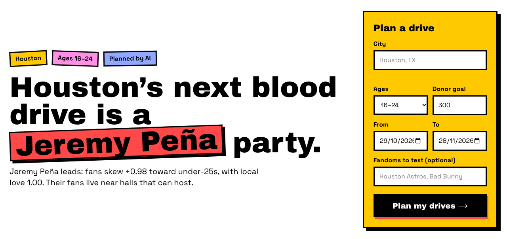
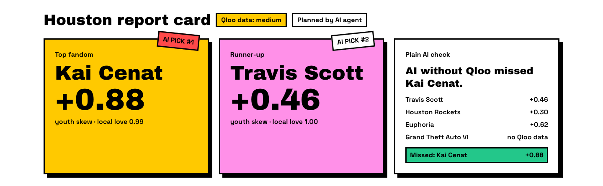
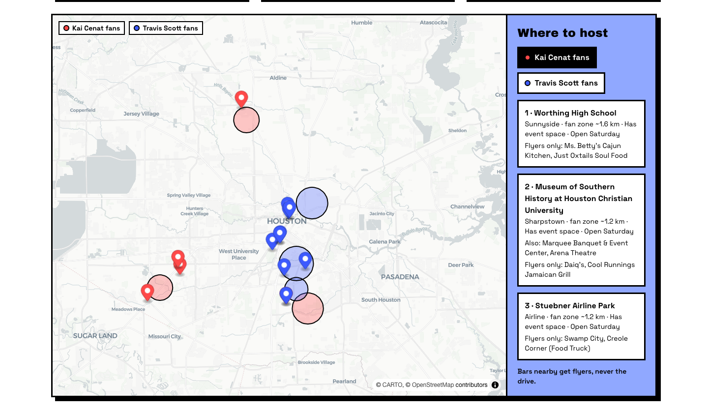
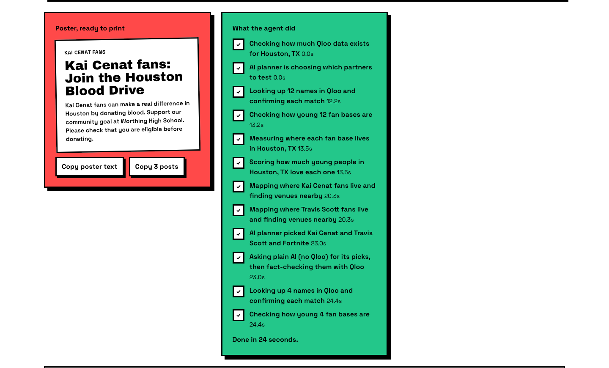
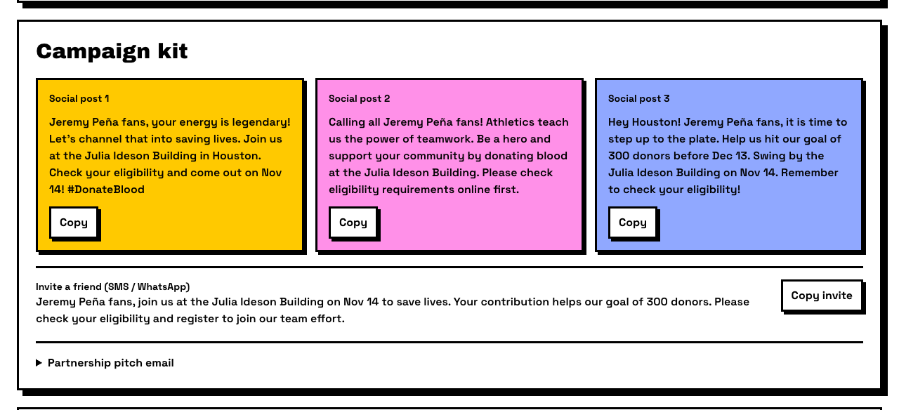
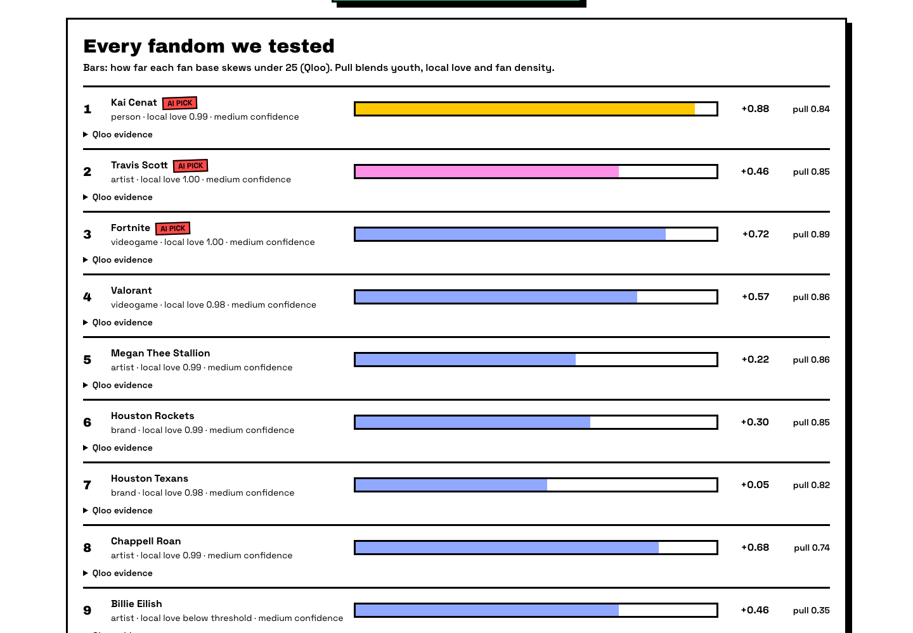
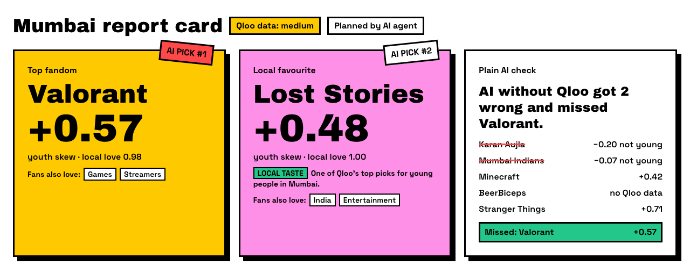
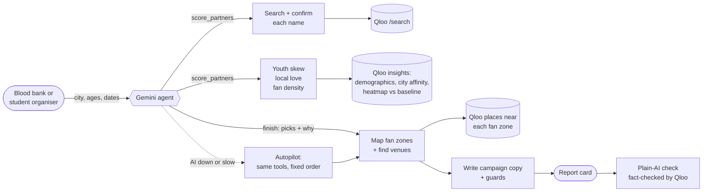
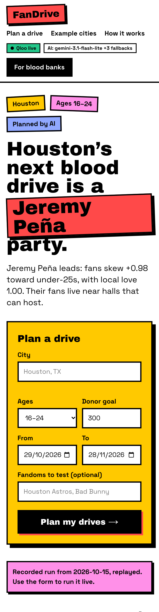

<div align="center">

# FanDrive

### Every fandom is a blood drive waiting to happen.

An AI agent for blood banks and student organisers. It uses **Qloo taste data** to find which fandoms skew young in your city, where those fans live and which venues nearby can host a drive. Then it writes the posters.


### [▶ Try the live demo](https://fandrive-nu.vercel.app) · [Watch Houston](https://fandrive-nu.vercel.app/plan?example=houston) · [Watch Mumbai](https://fandrive-nu.vercel.app/plan?example=mumbai)



</div>

---

## ⚡ Judges: try it in 60 seconds

| | |
|---|---|
| **1. Watch the agent** | Open [the app](https://fandrive-nu.vercel.app) and click **Watch Houston** (or Atlanta, Seattle, Mumbai). A recorded agent run replays in about 8 seconds. |
| **2. Run it live** | Type any city and press **Plan my drives**. The agent tests a dozen fandoms against Qloo and builds the plan live, usually in 25–90 seconds. |
| **3. Check the receipts** | Every partner has a **Qloo evidence** drop-down, and the **Plain AI check** shows what the same model suggests *without* Qloo. |

> **Live demo: https://fandrive-nu.vercel.app** · no sign-up, no API key.

---

## The problem

- 🩸 The American Red Cross declared its **second-ever national blood supply crisis** in August 2026.
- 📉 **Donors under 30 are down about 39% since 2015**, and high-school and college donors are down nearly half since the pandemic (Blood Centers of America, 2026). Only about **3% of eligible Americans** donate (AABB, 2026).
- 🎸 **Fandoms already fill blood drives:** the Red Cross × NFL partnership brought **150,000+ first-time donors**, and the Peanuts Snoopy shirt sent Red Cross search interest up **600%**.
- 🎯 **But partners are picked by gut feel.** Metallica's drives recruited only **16% first-timers**, and on Qloo their fans skew 45–54.

**FanDrive replaces the gut feel with taste data**, and tells you exactly where to set up.

---

## What you get

### 1 · The fandoms that bring young first-time donors

The agent proposes candidates (artists, teams, shows, games, creators), and Qloo adds its own **local taste**: what young people in your city love that other cities' young people don't. Qloo scores each one on **how young its fans are**, **how much your city's young people love it** and **how concentrated its fans are**. The agent then makes its picks, and every report leads with one **local pick**: Astros star Jeremy Peña and rapper Don Toliver in Houston, Seattle native Paolo Banchero in Seattle, Cade Cunningham in Detroit.



### 2 · Where the fans are, and where to host

Qloo heatmaps reveal the neighbourhoods where each fan base beats the city's baseline. FanDrive finds venues nearby and sorts them into **host here** (schools, colleges, halls, gyms, places of worship) and **flyers only** (cafés, restaurants, and bars, which never host).



### 3 · The agent shows its work, and the campaign is ready to print

Every step streams live as the agent works. The poster, three social posts, a friend invite and a partnership pitch email come out ready to copy.





### 4 · Every fandom, ranked with evidence



---

## 🧪 FanDrive vs plain AI

The same model is asked for partners **without Qloo**, then every pick is fact-checked against Qloo's age data.

**[20-city evaluation](docs/eval/README.md):** across 96 plain-AI picks in 15 US and 5 Indian cities, **31% had fans who skew older** than average and **60% were not young-skewing or had no Qloo data**. FanDrive's top 3 averaged youth skew **+0.74** vs **+0.25**, and in **every city** plain AI missed at least one of them. Qloo's local taste gave every city a **local pick** (18 different fandoms, such as Cade Cunningham in Detroit, Paolo Banchero in Seattle, STS9 in Denver and Indian Ocean in Mumbai). Re-run with `pnpm eval`; caveats are in the write-up.

| City | Plain AI suggested | What Qloo says |
|---|---|---|
| **Houston** | Travis Scott, Houston Rockets, Euphoria, Fortnite, Megan Thee Stallion | Megan Thee Stallion isn't young-skewing (+0.22). It **missed Houston's local picks**, Astros star Jeremy Peña (+0.98) and rapper Don Toliver (+0.69). |
| **Seattle** | Seattle Kraken, Minecraft, Macklemore, The Last of Us, Hasan Piker | 2 skew **older** (Macklemore −0.01, The Last of Us −0.05). It **missed Paolo Banchero (+0.99)**, the Seattle-born NBA star. |
| **Detroit** | Eminem, Detroit Lions, Fortnite, Big Sean, Stranger Things | 3 are **not young** (−0.06, +0.00, +0.05). It **missed Cade Cunningham (+0.87)**, the Pistons star who is Detroit's local pick. |
| **Mumbai** | Karan Aujla, Mumbai Indians, Minecraft, BeerBiceps, Stranger Things | 2 skew **older** (−0.20, −0.07), 1 has no data. It missed Lost Stories, the Indian electronic duo young Mumbaikars over-index on. |



> *"If your submission would work the same without Qloo, you're building the wrong thing."* Without Qloo, FanDrive would recommend famous names. With Qloo, it recommends the fan bases that are actually young, actually local, and actually near a hall that can host.

---

## How it works



**Young-Donor Pull** = 0.35 × youth skew + 0.45 × local love + 0.20 × fan density. Any fandom whose fans skew older always ranks below the young ones, and the agent can't override that.

**The full method**, with past blood-drive partners (NFL, Metallica, Game of Thrones, Peanuts) checked against Qloo next to their published results: **[fandrive-nu.vercel.app/method](https://fandrive-nu.vercel.app/method)**.

## How Qloo is used

| Endpoint and parameters | Why |
|---|---|
| `GET /search?query=…&types=urn:entity:…` | Resolve and confirm each candidate. Mismatches are excluded with a reason. |
| `GET /v2/insights` `filter.type=urn:demographics` + `signal.interests.entities` | Age skew of each fan base. |
| `GET /v2/insights` `filter.type=urn:entity:<type>` + `signal.location.query` + `signal.demographics.age` + `filter.results.entities` | How much young people in *this* city like each shortlisted fandom, in one call per type. |
| `GET /v2/insights` `filter.type=urn:entity:artist\|person` + `signal.location.query` + `signal.demographics.age` (no entity filter) | **Local taste**: what young people in the city over-index on. Names that also top more than one of 10 reference cities are dropped as national favourites. |
| `GET /v2/insights` `filter.type=urn:heatmap` + `filter.location.query` + `signal.interests.entities` | Where the fans are. Lift = fandom affinity rank minus a baseline of mass brands (Coca-Cola, Netflix, McDonald's, NFL, Taylor Swift). |
| `GET /v2/insights` `filter.type=urn:entity:place` + `filter.location=POINT(lon lat)` + `filter.location.radius` | Venues near each fan zone, ranked by affinity, young-crowd tags, event space and opening hours on the drive date. |

## 🤖 Use FanDrive from any AI agent (MCP)

FanDrive is also an MCP server, so Claude, Cursor or any other agent can plan drives with it. Same Qloo tools, same guards (rate limits, daily budget, input limits), read-only.

```bash
claude mcp add --transport http fandrive https://fandrive-nu.vercel.app/api/mcp
```

```json
{ "mcpServers": { "fandrive": { "url": "https://fandrive-nu.vercel.app/api/mcp" } } }
```

| Tool | What it does |
|---|---|
| `plan_blood_drive` | The full plan for a city: young-skewing fandoms, fan zones, host venues, the poster and a link to the report. |
| `score_fandoms` | Rank up to 12 names you choose by youth skew, local love and fan density. |
| `city_strength` | Is there enough Qloo data for this city? (strong, medium or thin) |

Then ask your agent: *"Which fandoms should a Houston blood drive partner with to reach 18–24 year olds?"*

## 🛡️ Built to be trusted

- **No invented facts.** Copy with numbers the tools never returned (digits *or* words, like "forty percent") falls back to template text.
- **No fake endorsements.** Public copy may only mention a fandom as fandom ("Kai Cenat fans"), never as if the artist, team or game were involved.
- **Sensible venues.** No drives at bars, shooting ranges, cigar or vape shops, tattoo parlours, children's schools or museums, or private homes.
- **Careful with people.** The agent never picks anyone who has died, is under 18 or is known for a scandal, and a plan led by a person reminds organisers to check fit.
- **Always finishes.** A Gemini fallback chain plus deadlines; if the AI is down, autopilot finishes the plan with the same Qloo tools.
- **Respects the API.** At most 3 Qloo requests/second, a pause on 429s, Redis caching, and a daily budget across all servers.
- **Private by design.** Only public names, cities and coordinates go to Qloo. Results are crowd-level tendencies, never about individuals. Keys stay server-side.
- **Prompt-injection safe.** User text reaches the agent only as data, and the agent can only call read-only tools.

<div align="center">

<br><em>Works on phones too.</em>
</div>

## Run locally

```bash
pnpm install
cp .env.example .env.local   # add QLOO_API_KEY and GOOGLE_GENERATIVE_AI_API_KEY
pnpm dev                     # http://localhost:3000
```

| Setting | What it does |
|---|---|
| `GEMINI_MODEL`, `GEMINI_FALLBACK_MODELS` | The model chain. The first model to answer is used. |
| `UPSTASH_REDIS_REST_URL`, `UPSTASH_REDIS_REST_TOKEN` | Shared cache, saved plans, rate limits and the daily budget. **Required in production.** |
| `QLOO_DAILY_BUDGET` | Uncached Qloo calls allowed per day across all servers (default 400). |
| `QLOO_CACHE_DIR` | Disk cache for scripts. `pnpm spike` and `pnpm record` use `.cache/qloo`. |

## Quality

- **203 tests** (Vitest), typecheck and lint on every push (GitHub Actions).
- Reviewed end to end by a separate code-review agent; every critical and important finding was fixed test-first.
- Live data spike and tuning notes: [`docs/spike/2026-10-13.md`](docs/spike/2026-10-13.md). Design spec: [`docs/superpowers/specs`](docs/superpowers/specs).

```bash
pnpm test && pnpm typecheck && pnpm lint && pnpm build
```

## Data limits

1. **City data varies.** Houston and Seattle are "medium"; rankings there are directional.
2. **Local love saturates.** Popular fandoms score 0.92–1.00, so city-specific signal comes from fan density.
3. **Youngest bucket is "24 and under".** It includes people too young to donate; eligibility rules always apply.
4. **India data is thinner.** Qloo's Indian city lists overlap a lot, so local picks there are often national favourites.
5. **"Local" is Qloo's view, not a hometown check.** Local picks are the artists and athletes young people in the city over-index on. Qloo's athlete data can be dated, and it can't know who has died; the agent is told to skip such names.
6. **Free-tier AI is flaky.** Gemini's free tier caps requests per model per day; FanDrive switches models, then falls back to autopilot.

## Roadmap

- **Organiser mode** for student groups (NSS, Rotaract, college clubs), with a simpler form and a shareable drive page.

## Licence

[MIT](LICENSE) © 2026 Abhishek Kumar

Built with Next.js 16, the Vercel AI SDK with Google Gemini, Qloo Taste AI, Upstash Redis and MapLibre. Built with the help of Claude Code (Anthropic).
